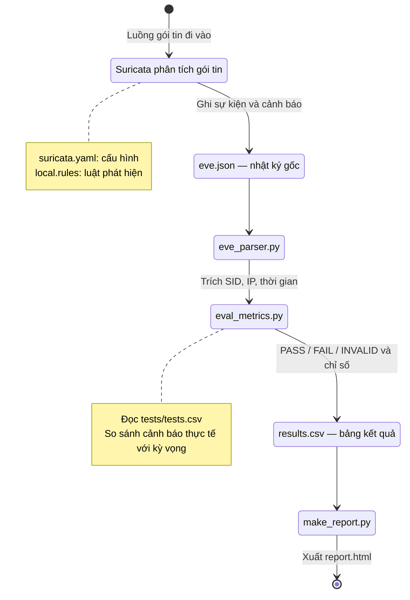

# IDS Suricata

Đã có: 4 luật mẫu, 14 ca thử, kiểm tra/liệt kê danh mục, parser EVE và logic đánh
giá có unit test bằng mock. Điều phối live/offline, sinh traffic, xác minh bằng
chứng và xuất HTML còn **TODO**.

## Luồng xử lý



Suricata là công cụ phân tích mạng; Python xử lý log sau khi engine ghi xong.
YAML và rules là cấu hình. `run_tests.py` điều phối lần chạy, đọc danh mục và
truyền kỳ vọng/ngữ cảnh cho evaluator; `metrics.json` lưu bảng chỉ số đi kèm kết quả.
Sơ đồ mô tả luồng mục tiêu; các bước còn TODO chưa vận hành tự động.

## Cấu trúc tối giản

```text
project-ids-suricata/
├── README.md
├── config/
│   ├── suricata.yaml        # overlay tham khảo
│   ├── nginx.conf
│   └── dnsmasq.conf
├── rules/local.rules
├── scripts/traffic_gen.sh   # TODO: sinh traffic
├── src/
│   ├── __init__.py
│   ├── run_tests.py         # kiểm tra/liệt kê; TODO: điều phối
│   ├── eve_parser.py        # EVE → alert và lỗi
│   ├── eval_metrics.py      # tập SID → kết quả và chỉ số
│   └── make_report.py       # TODO: kết quả → HTML
├── tests/
│   ├── tests.csv
│   ├── test_eve_parser.py
│   ├── test_eval_metrics.py
│   ├── fixtures/           # mock_eve.json, mock_results.csv
│   └── pcaps/              # TODO: T01.pcap … T14.pcap
└── results/                # đầu ra runtime, không đưa Git
```

Toàn bộ hướng dẫn nằm trong README này. Báo cáo, slide và video bổ sung khi có
sản phẩm thật; không tạo sẵn file giả. `.gitignore` và `.gitattributes` giữ quy tắc
bảo vệ dữ liệu và xuống dòng; `.gitkeep` chỉ giữ hai thư mục chưa có dữ liệu.

## Kiểm tra bộ khung

Từ thư mục gốc, cần Python >=3.10 và Bash; không cần cài thư viện Python ngoài:

```bash
python3 -m src.run_tests --check
python3 -m src.run_tests --list
python3 -m unittest discover -s tests -v
bash -n scripts/traffic_gen.sh
```

`--check` kiểm tra hợp đồng CSV, không kiểm chứng traffic hay luật Suricata.
`python3 -m src.run_tests --mode live` / `--mode offline`, thực thi traffic và
xuất báo cáo hiện trả lỗi TODO (mã 2), không tạo kết quả thực nghiệm.

## Lab và cấu hình mẫu

Phương án triển khai: hai VM Ubuntu Server 24.04 LTS, NAT để cài gói và Internal
Network `ids-lab` để thử; không giả định OVA tương thích x86 và ARM.

IP ví dụ local: Client `10.10.10.10/24`, Server `10.10.10.20/24`.
Thay địa chỉ/interface theo lab thật. Cloud firewall và firewall máy phải cho
Client private tới Server private ở TCP/80, UDP/53 và TCP/8000–8019; TCP/53 nếu
thử DNS/TCP. Gói bị chặn trước Server sẽ không tới Suricata. Chỉ thử trong lab.

- Chốt một phiên bản Suricata thống nhất trước thu số liệu; ghi version/hash.
- `config/suricata.yaml` là **overlay**, nạp sau cấu hình đầy đủ của bản đã cài;
  không dùng để ghi đè file hệ thống. Kiểm tra HTTP/DNS parser, drop, checksum/offload.
- `config/nginx.conf` là server block đặt trong `http{}`; kiểm tra `nginx -t`.
- `config/dnsmasq.conf` bind IP private; kiểm tra cổng 53/systemd-resolved và
  `dnsmasq --test --conf-file=...` trước khi khởi động.
- Chuẩn bị quyền capture/Nmap và SSH Server→Client nếu runner dùng SSH.
  Live chính thức cần dành riêng lab, tránh traffic nền và engine chạy trùng.

Lệnh minh họa sau khi môi trường đã sẵn sàng, **chưa được kiểm chứng ở bộ khung**:

```bash
suricata -T -c /etc/suricata/suricata.yaml --include config/suricata.yaml -S rules/local.rules
suricata -c /etc/suricata/suricata.yaml --include config/suricata.yaml -S rules/local.rules -r tests/pcaps/T01.pcap -l /path/to/new-case-dir
```

`-S` chỉ nạp luật nhóm; thư mục `-l` phải tồn tại và riêng cho ca. Live sẽ dùng
interface private (`-i`) và capture tại Server. Luôn đợi engine/capture dừng sạch,
kiểm tra mã thoát rồi mới đọc kết quả. Không có lệnh cài đặt tự động ở thời điểm này.

## Luật và 14 ca thử

Luật mẫu: URI chính xác `/ids-demo-check` → **1000001**; User-Agent chính xác
`IDS-LAB-TEST` → **1000002**; DNS chính xác `alert.ids.test` (không phân biệt
hoa/thường) → **1000003**; ≥10 SYN khớp/10 giây theo nguồn, threshold `both`,
dải 8000–8019 → **1000004**. Ba marker không tự chứng minh tấn công; HTTP bản rõ
có giới hạn với HTTPS không giải mã. Luật SYN không đếm cổng duy nhất hoặc bao phủ
mọi kiểu quét. LAB_CLIENT/LAB_SERVER giúp hai máy cùng HOME_NET vẫn khớp.
**Phải kiểm tra `suricata -T` và traffic thật; chưa xác nhận luật đã chạy.**

| Ca | Input | Expected SID |
| --- | --- | --- |
| T01 | URI /ids-demo-check | 1000001 |
| T02 | URI /index.html | Rỗng |
| T03 | User-Agent IDS-LAB-TEST, URI thường | 1000002 |
| T04 | User-Agent Mozilla/5.0, URI thường | Rỗng |
| T05 | DNS alert.ids.test | 1000003 |
| T06 | DNS normal.ids.test | Rỗng |
| T07 | URI /ids-demo-check-safe | Rỗng |
| T08 | User-Agent IDS-LAB-TESTX | Rỗng |
| T09 | DNS alert.ids.test.evil | Rỗng |
| T10 | DNS notalert.ids.test | Rỗng |
| T11 | URI và User-Agent cùng khớp | 1000001;1000002 |
| T12 | URI khớp lặp đúng 3 lần | 1000001, vẫn chỉ một ca |
| T13 | SYN 20 cổng 8000–8019 trong 10 giây | 1000004 |
| T14 | Một SYN tới 8000, không retry | Rỗng |

Offline: **14 ca × 3 lượt = 42 lần thử**, engine mới cho mỗi ca/lượt để đặt lại
trạng thái. Không đưa cả thư mục PCAP vào một engine rồi coi các ca độc lập.
Live tối thiểu T01–T06 và T13–T14; tách kết quả/chỉ số live và offline.
PCAP phía Server cần xác nhận handshake/request HTTP, query DNS, T12 đúng 3
request, T13 đúng dải/tốc độ và T14 đúng một SYN. Mã thoát công cụ không đủ
xác nhận traffic. PCAP/video đã kiểm chứng là dự phòng demo, phải ghi rõ mode.

## Dữ liệu và đánh giá

`tests/tests.csv`: `test_id,description,protocol,target_ip,target_port,input_spec,expected_sids`.
`input_spec` là JSON object trong ô CSV, không được `eval` hoặc ghép thành lệnh shell.
Kỳ vọng chốt trước chạy; SID cách nhau bằng `;`, ô rỗng nghĩa là tập rỗng.

Mỗi ca/lượt có một dòng `results.csv`:

```text
run_id,test_id,expected_sids,observed_sids,traffic_valid,status,evidence_dir
```

`traffic_valid` ghi `true`/`false`, parse tường minh. Không trùng run_id/test_id.
Bằng chứng: `results/<mode>_<run_id>/<test_id>/{input.pcap,eve.json,manifest.json}`;
mỗi run có thêm `results.csv`, `metrics.json`, `report.html`. Không ghi đè run cũ.
PCAP chuẩn nằm ở `tests/pcaps/`; `input.pcap` là bản thực tế dùng trong lần chạy.
Manifest dự kiến ghi mode/run/test, phiên bản, Git commit, hash cấu hình/luật/danh
mục/PCAP, argv, thời gian có timezone, mã thoát, trạng thái đóng engine/capture/log,
số lỗi parser và bằng chứng xác minh traffic. Runner gắn run_id/test_id; EVE không
tự có chúng. Các bước xác minh/ghi file vẫn còn TODO.

- **PASS:** traffic, engine, log và bằng chứng hợp lệ; hai tập SID bằng nhau.
- **FAIL:** lần chạy hợp lệ nhưng tập SID khác nhau, kể cả có SID ngoài nhóm.
- **INVALID:** traffic/engine/capture lỗi, log hỏng hoặc thiếu bằng chứng; loại khỏi ma trận.

Không alert chưa đủ kết luận ca âm PASS. Parser phải báo số dòng lỗi; lỗi parse,
I/O hoặc encoding không được biến thành tập alert rỗng. Hiện parser giữ timestamp
ở dạng chuỗi; kiểm tra thời gian/timezone/IP/phạm vi ca khi tích hợp còn TODO.
Evaluator hiện nhận các cờ đã xác minh từ caller, chưa tự kiểm chứng PCAP/manifest.

TP/FP/TN/FN tính theo từng **cặp ca–SID** trong 4 SID. Expected có/observed có → TP;
có/không → FN; không/có → FP; không/không → TN. Expected SID 1 nhưng thấy SID 2
là một FN, một FP và ca FAIL. SID ngoài nhóm vẫn gây FAIL, không thêm vào ma trận.
Precision = TP/(TP+FP), Recall = TP/(TP+FN); mẫu số 0 → **N/A** (`null` trong JSON).
Không đếm số alert thành số ca; không gọi thời gian xử lý cả PCAP là độ trễ từng gói.
Kết luận giới hạn trong dữ liệu lab.

`tests/fixtures/` chỉ chứa **mock để kiểm thử code**, không dùng làm số liệu thật.
`results/`, `.env` thật, key/token, cấu hình `*.local.*`, log, VM/video lớn bị ignore.
PCAP chuẩn được phép Git theo dõi: kiểm tra dữ liệu nhạy cảm và kích thước trước
commit. Không đưa thông tin VPS thật lên repository public.

## Việc còn lại và mốc hoàn thành

Hoàn thiện runner/traffic generator, lock lab, manifest/xác minh bằng chứng,
parser tích hợp và HTML; tạo PCAP thật rồi chạy đủ live/offline. Viết báo cáo,
làm slide/video sau khi có dữ liệu. Dùng nhánh riêng, commit nhỏ, review trước merge;
không sửa expected sau khi thấy kết quả.

Năm 2026: bắt đầu 02/11; chốt tính năng 29/11; đủ số liệu và báo cáo đầy đủ 06/12;
đóng băng code 10/12; hoàn tất nội bộ 13/12; kiểm tra/diễn tập 14–18/12;
**hạn cuối 18/12**.

## Tham khảo chính thức

Tài liệu Suricata 8.0.0 là tham khảo, chưa phải phiên bản đã cài:

- [Dòng lệnh: -T, -r, --include, -S](https://docs.suricata.io/en/suricata-8.0.0/command-line-options.html)
- [EVE JSON](https://docs.suricata.io/en/suricata-8.0.0/output/eve/eve-json-format.html)
- [HTTP](https://docs.suricata.io/en/suricata-8.0.0/rules/http-keywords.html), [DNS](https://docs.suricata.io/en/suricata-8.0.0/rules/dns-keywords.html)
- [Payload/bsize](https://docs.suricata.io/en/suricata-8.0.0/rules/payload-keywords.html), [threshold](https://docs.suricata.io/en/suricata-8.0.0/rules/thresholding.html)
- [Nmap SYN scan](https://nmap.org/book/man-port-scanning-techniques.html)
