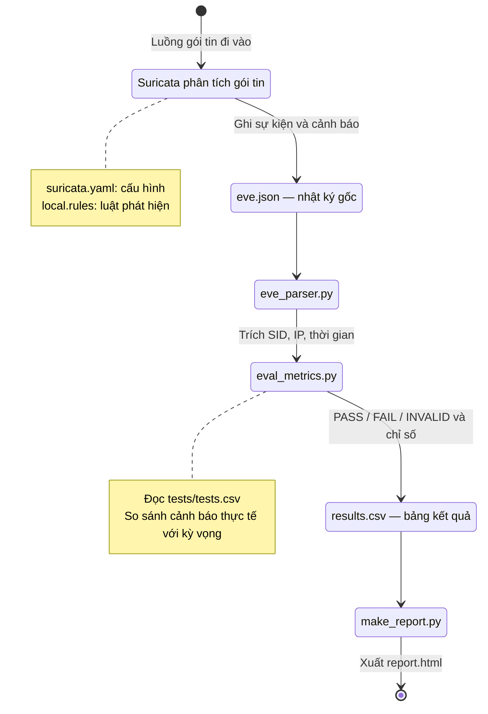

# IDS Suricata

Đã có hai script chạy Suricata live/offline, 4 luật mẫu, 14 ca thử, parser EVE và
logic đánh giá có unit test bằng mock. Tích hợp runner Python, sinh traffic, xác
minh bằng chứng và xuất HTML còn **TODO**.

## Luồng xử lý



Suricata là công cụ phân tích mạng; Python xử lý log sau khi engine ghi xong.
YAML và rules là cấu hình. `run_tests.py` điều phối lần chạy, đọc danh mục và
truyền kỳ vọng/ngữ cảnh cho evaluator; `metrics.json` lưu bảng chỉ số đi kèm kết quả.
Sơ đồ mô tả luồng mục tiêu; các bước còn TODO chưa vận hành tự động.

## Cấu trúc tối giản

```text
project-ids-suricata/
├── README.md               # Hướng dẫn mục tiêu, luồng xử lý, cách kiểm tra và dữ liệu của dự án
├── config/                 # Cấu hình mẫu cho Suricata và các dịch vụ nhận lưu lượng kiểm thử
│   ├── suricata.yaml       # Cấu hình chính của lab: IP, bộ luật và các loại sự kiện EVE
│   ├── nginx.conf          # Cấu hình web HTTP cổng 80 để nhận yêu cầu thử URI và User-Agent
│   └── dnsmasq.conf        # Cấu hình DNS cổng 53 để nhận và trả lời truy vấn tên miền trong lab
├── rules/local.rules       # Bốn luật mẫu phát hiện marker URI, User-Agent, DNS và SYN dồn dập
├── scripts/run_live.sh     # Cập nhật repo và quản lý phiên live bằng systemd
├── scripts/run_offline.sh  # Cập nhật repo, đọc từng PCAP và xuất EVE
├── scripts/lib/            # Khóa checkout, cập nhật Git và kiểm tra cấu hình chung
├── scripts/traffic_gen.sh  # TODO: tạo yêu cầu HTTP, truy vấn DNS hoặc gói SYN theo từng ca thử
├── src/                    # Mã Python đọc danh mục, xử lý log, đánh giá và tạo báo cáo
│   ├── __init__.py         # Đánh dấu src là package Python để các module import và chạy cùng nhau
│   ├── run_tests.py        # Đọc/kiểm tra/liệt kê ca thử; TODO: điều phối live/offline và thu bằng chứng
│   ├── eve_parser.py       # Đọc eve.json, trích SID/IP/thời gian, giữ danh sách alert và báo lỗi từng dòng
│   ├── eval_metrics.py     # So sánh tập SID, xác định PASS/FAIL/INVALID và tính TP/FP/TN/FN, precision/recall
│   └── make_report.py      # TODO: đọc bảng kết quả và chỉ số đã đánh giá để tạo report.html
├── tests/                  # Danh mục ca thử, dữ liệu đầu vào và kiểm thử logic Python
│   ├── tests.csv           # Mô tả 14 ca: giao thức, IP/cổng đích, tham số tạo traffic và SID kỳ vọng
│   ├── test_eve_parser.py  # Kiểm tra đọc alert, gộp SID trùng và báo lỗi log bằng dữ liệu giả
│   ├── test_eval_metrics.py # Kiểm tra so sánh SID, loại INVALID và tính đúng các chỉ số đánh giá
│   ├── fixtures/           # mock_eve.json và mock_results.csv: dữ liệu giả thử code, không phải số liệu lab
│   └── pcaps/              # TODO: lưu T01.pcap … T14.pcap làm bộ đầu vào chuẩn để chạy offline
└── results/                # Lưu PCAP/EVE/manifest và CSV/JSON/HTML theo từng lần chạy; không đưa Git
```

Hướng dẫn chung nằm trong README này. Báo cáo, slide và video bổ sung khi có
sản phẩm thật; không tạo sẵn file giả. `.gitignore` và `.gitattributes` giữ quy tắc
bảo vệ dữ liệu và xuống dòng; `.gitkeep` chỉ giữ hai thư mục chưa có dữ liệu.

## Kiểm tra bộ khung

Từ thư mục gốc, cần Python >=3.10 và Bash; không cần cài thư viện Python ngoài:

```bash
python3 -m src.run_tests --check
python3 -m src.run_tests --list
python3 -m unittest discover -s tests -v
bash -n scripts/traffic_gen.sh
```

`--check` kiểm tra hợp đồng CSV, không kiểm chứng traffic hay luật Suricata.
`python3 -m src.run_tests --mode live` / `--mode offline`, thực thi traffic và
xuất báo cáo hiện trả lỗi TODO (mã 2), không tạo kết quả thực nghiệm.

## Triển khai lab

Server lab hiện dùng **Suricata 8.0.3 RELEASE**. Mỗi lượt dùng bản sao
`config/suricata.yaml` và `rules/` lấy từ commit vừa kéo về. Bản sao và mã
commit (`git-commit.txt`) nằm trong thư mục kết quả của lượt đó.

Tên thư mục kết quả dùng giờ Việt Nam (UTC+7), có hậu tố `+0700` trong phần
thời gian. Ví dụ `results/live_20261113T171500+0700.A1b2C3/` là phiên tạo lúc
17:15 ngày 13/11/2026. Thư mục offline dùng cùng định dạng với tiền tố `offline_`.

### 1. Chuẩn bị hai máy

| Máy | IP lab | Vai trò |
| --- | --- | --- |
| Client | `10.10.10.10/24` | Gửi lưu lượng thử |
| Server | `10.10.10.20/24` | Chạy nginx và Suricata, lưu PCAP và EVE |

Trên hai VM Ubuntu Server 24.04 LTS trong VirtualBox, dùng một adapter NAT để
cài gói và kéo repo, cùng một adapter Internal Network tên `ids-lab` để thử.
Gán IP ở bảng trên cho adapter Internal Network và để default gateway trên
adapter NAT.

Trên **Server**, cài các gói phụ trợ, kiểm tra phiên bản Suricata và dừng service
mặc định để mỗi lượt thử dùng một tiến trình riêng. Nếu VM mới chưa có Suricata,
xem [hướng dẫn cài trên Ubuntu của OISF](https://docs.suricata.io/en/suricata-8.0.3/install/ubuntu.html)
và kiểm tra phiên bản thực tế trước khi thu số liệu.

```bash
sudo apt update
sudo apt install -y git nginx python3 tcpdump
suricata -V
sudo systemctl disable --now suricata
```

Trên **Client**, cài `curl` bằng `sudo apt install -y curl`. Cho phép Client truy
cập TCP/80 của Server qua mạng lab. Khi mở rộng sang ca DNS hoặc SYN, cấu hình
firewall riêng cho các cổng tương ứng trong danh mục ca thử.

### 2. Clone repo trên Server

Clone bằng tài khoản thường. Dùng một bản clone triển khai sạch trên nhánh `main`
để có thể cập nhật trực tiếp từ `origin/main`. Nếu đã clone, vào thư mục có sẵn.

```bash
git clone https://github.com/snam05/project-ids-suricata.git
cd project-ids-suricata
git switch main
git pull --ff-only origin main
```

Mỗi lần `run_live.sh start` hoặc `run_offline.sh` thực hiện các bước sau:

1. Lấy khóa của bản clone và chạy `git pull --ff-only origin main`. Nếu một
   lượt khác đang chuẩn bị đầu vào, lệnh đợi đến khi lấy được khóa.
2. In một dòng `[commit][live]` hoặc `[commit][offline]` ngay sau khi cập nhật
   thành công, trước phiên bản Suricata và bước kiểm tra config.
3. Lưu mã commit, sao chép config và rules từ commit đó vào thư mục lượt, rồi
   sao chép các PCAP đầu vào nếu chạy offline. Sau đó nhả khóa.
4. Kiểm tra config và rules của lượt bằng `suricata -T --init-errors-fatal`.
   Khi kiểm tra thành công, mở phiên live hoặc xử lý lần lượt từng PCAP.

Dòng commit hiển thị nhánh nguồn, mã đầy đủ, thời điểm commit kèm múi giờ, tác
giả và dòng tiêu đề của thông điệp commit. Script in dòng này ra terminal qua
`stderr` để có thể thu cùng các thông báo kiểm tra. Ví dụ định dạng:

```text
[commit][live] origin/main | 0123456789abcdef0123456789abcdef01234567 | 2026-11-13T17:00:00+07:00 | Lan Nguyen | Update lab rules
```

Nếu cần tra lại thông tin từ kết quả cũ, chạy lệnh sau từ bản clone. Thay
`THU_MUC_LUOT` bằng đường dẫn thư mục phiên live hoặc lượt offline đã in ra:

```bash
git show --no-patch "$(cat THU_MUC_LUOT/git-commit.txt)"
```

Live và offline có thể chạy song song theo thứ tự bất kỳ sau khi nhả khóa.
Dùng cùng bản clone để các lệnh chia sẻ khóa. Mỗi Server có tối đa một phiên
live. Nếu cập nhật hoặc kiểm tra thất bại, script báo lỗi trước khi chạy engine
cho lượt thử. Đưa thay đổi của nhóm lên `main` để Server nhận chúng. Nếu lab đổi
IP, đồng bộ `HOME_NET`, `LAB_CLIENT`, `LAB_SERVER` trong `config/suricata.yaml`,
địa chỉ nghe của dịch vụ trong `config/` và
`target_ip` trong `tests/tests.csv` trước khi đưa thay đổi lên `main`.

### 3. Chạy live

Trên **Server**, xác định interface ở sau `dev` trong kết quả `ip route get`.
Nếu thử HTTP, bật nginx bằng server block trong repo trước khi gửi request.

```bash
sudo install -m 0644 config/nginx.conf /etc/nginx/conf.d/ids-lab.conf
sudo nginx -t && sudo systemctl reload nginx
ip -4 route get 10.10.10.10
```

Thay `TEN_CARD` bằng interface vừa xác định:

```bash
./scripts/run_live.sh start TEN_CARD
./scripts/run_live.sh status
```

`start` chạy một tiến trình nền bằng unit tạm `suricata-ids-lab.service` và chờ
engine sẵn sàng. Tiến trình tiếp tục khi đóng SSH. Script tự gọi `sudo` để điều
khiển systemd. Nếu phiên đang chạy, dùng `stop` trước khi bắt đầu phiên mới.
`status` hiển thị trạng thái phiên và đường dẫn EVE. `status` và `stop` dùng
phiên hiện tại, vì vậy hai lệnh này không kéo repo.

Nếu muốn thu PCAP của T01 để chạy offline, mở terminal thứ hai trên Server
sau khi `start` báo thành công. Dùng cùng interface và thư mục phiên đã in ra:

```bash
iface=TEN_CARD
case_dir=/duong/dan/toi/thu_muc_phien_live
sudo tcpdump -i "$iface" -Z "$(id -un)" -s 0 -w "$case_dir/input.pcap" \
  'host 10.10.10.10 and tcp port 80'
```

Để thử T01, gửi yêu cầu từ **Client** sau khi Suricata sẵn sàng và tcpdump
đã bắt đầu nghe nếu dùng bước thu PCAP:

```bash
curl --noproxy '*' --http1.1 --fail --show-error --max-time 10 http://10.10.10.20/ids-demo-check
```

Nếu đang chạy tcpdump, bấm `Ctrl+C` trong terminal đó để đóng PCAP. Sau đó
kết thúc phiên trên **Server**:

```bash
./scripts/run_live.sh stop
```

`stop` gửi `SIGINT`, chờ engine đóng file và in đường dẫn `eve.json`. File
được giữ tại `results/live_<thời_gian>.<hậu_tố>/eve.json`. Với T01, kiểm tra
`alert.signature_id` có giá trị `1000001`. Lần `start` sau tạo tiến trình và
thư mục mới. Xem lỗi bằng `sudo journalctl -u suricata-ids-lab.service -b`.

### 4. Đọc lại PCAP offline

Truyền một hoặc nhiều file PCAP đã có. Ví dụ, dùng file vừa bắt trong phiên live
hoặc các file đã đưa vào `tests/pcaps/`.

```bash
./scripts/run_offline.sh /duong/dan/toi/input.pcap
./scripts/run_offline.sh tests/pcaps/T01.pcap tests/pcaps/T02.pcap
```

Mỗi lần gọi script tạo một lượt `results/offline_<thời_gian>.<hậu_tố>/`. Script
sao chép PCAP thành `001/input.pcap`, `002/input.pcap` theo thứ tự đối số. Mỗi
PCAP có một tiến trình Suricata riêng, ghi `eve.json` cạnh bản sao đó. Truyền
PCAP đã ghi xong để bản sao chứa đầy đủ dữ liệu. Runner Python vẫn đang ở bước
kiểm tra và liệt kê danh mục.

## Luật và 14 ca thử

Luật mẫu: URI chính xác `/ids-demo-check` → **1000001**; User-Agent chính xác
`IDS-LAB-TEST` → **1000002**; DNS chính xác `alert.ids.test` (không phân biệt
hoa/thường) → **1000003**; ≥10 SYN khớp/10 giây theo nguồn, threshold `both`,
dải 8000–8019 → **1000004**. Ba marker không tự chứng minh tấn công; HTTP bản rõ
có giới hạn với HTTPS không giải mã. Luật SYN không đếm cổng duy nhất hoặc bao phủ
mọi kiểu quét. LAB_CLIENT/LAB_SERVER giúp hai máy cùng HOME_NET vẫn khớp.
**Phải kiểm tra `suricata -T` và traffic thật; chưa xác nhận luật đã chạy.**

| Ca | Input | Expected SID |
| --- | --- | --- |
| T01 | URI /ids-demo-check | 1000001 |
| T02 | URI /index.html | Rỗng |
| T03 | User-Agent IDS-LAB-TEST, URI thường | 1000002 |
| T04 | User-Agent Mozilla/5.0, URI thường | Rỗng |
| T05 | DNS alert.ids.test | 1000003 |
| T06 | DNS normal.ids.test | Rỗng |
| T07 | URI /ids-demo-check-safe | Rỗng |
| T08 | User-Agent IDS-LAB-TESTX | Rỗng |
| T09 | DNS alert.ids.test.evil | Rỗng |
| T10 | DNS notalert.ids.test | Rỗng |
| T11 | URI và User-Agent cùng khớp | 1000001;1000002 |
| T12 | URI khớp lặp đúng 3 lần | 1000001, vẫn chỉ một ca |
| T13 | SYN 20 cổng 8000–8019 trong 10 giây | 1000004 |
| T14 | Một SYN tới 8000, không retry | Rỗng |

Offline: **14 ca × 3 lượt = 42 lần thử**, engine mới cho mỗi ca/lượt để đặt lại
trạng thái. Không đưa cả thư mục PCAP vào một engine rồi coi các ca độc lập.
Live tối thiểu T01–T06 và T13–T14; tách kết quả/chỉ số live và offline.
PCAP phía Server cần xác nhận handshake/request HTTP, query DNS, T12 đúng 3
request, T13 đúng dải/tốc độ và T14 đúng một SYN. Mã thoát công cụ không đủ
xác nhận traffic. PCAP/video đã kiểm chứng là dự phòng demo, phải ghi rõ mode.

## Dữ liệu và đánh giá

`tests/tests.csv`: `test_id,description,protocol,target_ip,target_port,input_spec,expected_sids`.
`input_spec` là JSON object trong ô CSV, không được `eval` hoặc ghép thành lệnh shell.
Kỳ vọng chốt trước chạy; SID cách nhau bằng `;`, ô rỗng nghĩa là tập rỗng.

Mỗi ca/lượt có một dòng `results.csv`:

```text
run_id,test_id,expected_sids,observed_sids,traffic_valid,status,evidence_dir
```

`traffic_valid` ghi `true`/`false`, parse tường minh. Không trùng run_id/test_id.
Bằng chứng: `results/<mode>_<run_id>/<test_id>/{input.pcap,eve.json,manifest.json}`;
mỗi run có thêm `results.csv`, `metrics.json`, `report.html`. Không ghi đè run cũ.
PCAP chuẩn nằm ở `tests/pcaps/`; `input.pcap` là bản thực tế dùng trong lần chạy.
Manifest dự kiến ghi mode/run/test, phiên bản, Git commit, hash cấu hình/luật/danh
mục/PCAP, argv, thời gian có timezone, mã thoát, trạng thái đóng engine/capture/log,
số lỗi parser và bằng chứng xác minh traffic. Runner gắn run_id/test_id; EVE không
tự có chúng. Các bước xác minh/ghi file vẫn còn TODO.

- **PASS:** traffic, engine, log và bằng chứng hợp lệ; hai tập SID bằng nhau.
- **FAIL:** lần chạy hợp lệ nhưng tập SID khác nhau, kể cả có SID ngoài nhóm.
- **INVALID:** traffic/engine/capture lỗi, log hỏng hoặc thiếu bằng chứng; loại khỏi ma trận.

Không alert chưa đủ kết luận ca âm PASS. Parser phải báo số dòng lỗi; lỗi parse,
I/O hoặc encoding không được biến thành tập alert rỗng. Hiện parser giữ timestamp
ở dạng chuỗi; kiểm tra thời gian/timezone/IP/phạm vi ca khi tích hợp còn TODO.
Evaluator hiện nhận các cờ đã xác minh từ caller, chưa tự kiểm chứng PCAP/manifest.

TP/FP/TN/FN tính theo từng **cặp ca–SID** trong 4 SID. Expected có/observed có → TP;
có/không → FN; không/có → FP; không/không → TN. Expected SID 1 nhưng thấy SID 2
là một FN, một FP và ca FAIL. SID ngoài nhóm vẫn gây FAIL, không thêm vào ma trận.
Precision = TP/(TP+FP), Recall = TP/(TP+FN); mẫu số 0 → **N/A** (`null` trong JSON).
Không đếm số alert thành số ca; không gọi thời gian xử lý cả PCAP là độ trễ từng gói.
Kết luận giới hạn trong dữ liệu lab.

`tests/fixtures/` chỉ chứa **mock để kiểm thử code**, không dùng làm số liệu thật.
`results/`, `.env` thật, key/token, cấu hình `*.local.*`, log, VM/video lớn bị ignore.
PCAP chuẩn được phép Git theo dõi: kiểm tra dữ liệu nhạy cảm và kích thước trước
commit. Không đưa thông tin VPS thật lên repository public.

## Việc còn lại và mốc hoàn thành

Hoàn thiện runner/traffic generator, lock lab, manifest/xác minh bằng chứng,
parser tích hợp và HTML; tạo PCAP thật rồi chạy đủ live/offline. Viết báo cáo,
làm slide/video sau khi có dữ liệu. Dùng nhánh riêng, commit nhỏ, review trước merge;
không sửa expected sau khi thấy kết quả.

Năm 2026: bắt đầu 02/11; chốt tính năng 29/11; đủ số liệu và báo cáo đầy đủ 06/12;
đóng băng code 10/12; hoàn tất nội bộ 13/12; kiểm tra/diễn tập 14–18/12;
**hạn cuối 18/12**.

## Tham khảo chính thức

Tài liệu theo phiên bản đang dùng trên Server lab, Suricata 8.0.3:

- [Tùy chọn `-c`, `-T`, `--pcap`, `-r`, `-l`](https://docs.suricata.io/en/suricata-8.0.3/command-line-options.html)
- [Cấu hình `default-rule-path` và `rule-files`](https://docs.suricata.io/en/suricata-8.0.3/configuration/suricata-yaml.html#rule-files)
- [EVE JSON](https://docs.suricata.io/en/suricata-8.0.3/output/eve/eve-json-format.html)
- [HTTP](https://docs.suricata.io/en/suricata-8.0.3/rules/http-keywords.html), [DNS](https://docs.suricata.io/en/suricata-8.0.3/rules/dns-keywords.html)
- [Payload/bsize](https://docs.suricata.io/en/suricata-8.0.3/rules/payload-keywords.html), [threshold](https://docs.suricata.io/en/suricata-8.0.3/rules/thresholding.html)
- [Nmap SYN scan](https://nmap.org/book/man-port-scanning-techniques.html)
