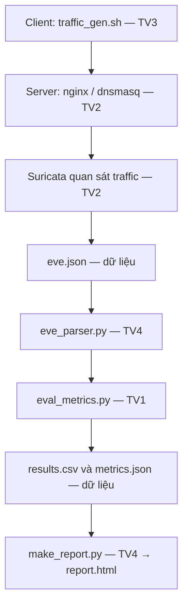

# IDS Suricata — bộ khung đồ án nhóm 4 người

**“Triển khai và kiểm chứng hệ thống phát hiện xâm nhập mạng bằng Suricata trong môi trường lab”.**

Trạng thái: **bộ khung để nhóm phát triển tiếp**, chưa dựng VPS, chưa có PCAP thật,
chưa chạy Suricata hoặc thu số liệu. Không dùng Docker. Chưa có báo cáo Word/PDF,
slide, video hoặc report.html thực nghiệm; thư mục tương ứng có hướng dẫn TODO.

Đã có: cấu trúc dự án; cấu hình và 4 luật **tham khảo**; danh mục 14 ca;
module Python với trách nhiệm/đầu vào/đầu ra; tiện ích kiểm tra/liệt kê;
parser EVE tối thiểu và logic đánh giá tập SID có kiểm thử bằng **mock**.
Runner live/offline, sinh traffic, kiểm chứng bằng chứng và tạo HTML còn TODO.

## 1. Mục tiêu và phạm vi

Quan sát HTTP/DNS/TCP SYN trong lab, ghi EVE, đối chiếu SID kỳ vọng với SID
quan sát rồi báo cáo kết quả có PCAP/log/manifest truy vết. Ba chuỗi HTTP/DNS
là marker thử nghiệm, không tự chứng minh tấn công thực tế. HTTP dùng bản rõ;
HTTPS không giải mã có giới hạn quan sát nội dung. Luật SYN chỉ báo gói dồn dập,
không đếm số cổng duy nhất, không bao phủ mọi kiểu quét. Kết luận trong dữ liệu lab.

## 2. Hai máy của lab

Hướng hiện tại: hai VPS cùng nhà cung cấp, region và mạng riêng VPC:

```text
VPS Client                         VPS Server + IDS
curl / dig / Nmap  -- IP private --> nginx :80 / dnsmasq :53
                                     Suricata quan sát traffic
                                     Python xử lý EVE sau khi ghi xong
```

Chưa có nhà cung cấp, IP, tài khoản hoặc VPS thật. Cloud firewall phải cho phép
traffic từ Client tới Server, gồm TCP/8000–8019; chặn trước VPS thì cảm biến
không thấy gói. Mỗi người có tài khoản/thư mục riêng, đồng bộ code qua Git.
Đặt lịch lab độc quyền khi chạy live chính thức để tránh nhiễu.

Phương án thay thế: hai VM Ubuntu Server 24.04 LTS, cùng phiên bản;
NAT để cài gói và Internal Network `ids-lab` để thử. Ví dụ Client
`10.10.10.10/24`, Server `10.10.10.20/24` — đây chỉ là IP mẫu.
TV2 dựng môi trường chuẩn, TV1 kiểm tra bàn giao; không mặc định OVA tương thích
xuyên Intel/AMD và ARM. Xem [hướng dẫn hạ tầng](docs/lab-setup.md).

## 3. Luồng và trách nhiệm

Luồng dữ liệu chính:



Mũi tên từ dịch vụ tới Suricata chỉ quan hệ quan sát trên Server, không có
chương trình nginx chuyển từng gói sang Python. Suricata/nginx/dnsmasq/tcpdump
là công cụ có sẵn. `config/suricata.yaml` (TV2) và `rules/local.rules` (TV3)
là cấu hình Suricata nạp, không phải chương trình chạy nối tiếp.

Trước luồng trên, `run_tests.py` (TV1) đọc `tests/tests.csv` (TV3), tạo run_id,
gắn test_id và điều phối. Phương án dự kiến: runner trên Server gọi
`traffic_gen.sh` trên Client qua SSH do TV2 chuẩn bị; **chưa triển khai**.
Runner không phải bộ máy phát hiện; Python xử lý log sau Suricata.

| Người | File chính | Trách nhiệm |
| --- | --- | --- |
| TV1 | src/run_tests.py, src/eval_metrics.py | Điều phối, xác minh lần chạy, đánh giá; tổng quan/khảo sát/kết luận, biên tập báo cáo và ghép slide |
| TV2 | config/suricata.yaml, config/nginx.conf, config/dnsmasq.conf, scripts/lab.sh | Client/Server, mạng, dịch vụ, quyền công cụ, SSH, cài đặt/tái lập |
| TV3 | rules/local.rules, tests/tests.csv, scripts/traffic_gen.sh, tests/pcaps/ | Luật, expected, traffic, PCAP, demo |
| TV4 | src/eve_parser.py, src/make_report.py, tests/fixtures/ | Parser/mock/test, HTML, phần log trong báo cáo, video dự phòng |

Mỗi người tự viết báo cáo và slide phần mình. TV1 không ôm việc dựng hạ tầng
của TV2. Xem [kế hoạch và bàn giao](docs/team-plan.md).

## 4. Cấu trúc

```text
project-ids-suricata/
├── README.md, requirements.txt, .gitignore, .env.example
├── config/       suricata.yaml (overlay), nginx.conf, dnsmasq.conf
├── rules/        local.rules
├── scripts/      lab.sh, traffic_gen.sh, check_scaffold.py
├── src/          __init__.py, contracts.py, run_tests.py,
│                 eve_parser.py, eval_metrics.py, make_report.py
├── tests/        tests.csv, test_eve_parser.py, test_eval_metrics.py
│   ├── fixtures/ mock_eve.json, mock_results.csv, README.md
│   └── pcaps/    README.md — TODO T01.pcap … T14.pcap
├── results/      README.md — đầu ra runtime bị gitignore
├── docs/         lab-setup.md, data-contract.md, team-plan.md
├── report/       README.md — TODO report.docx/pdf
├── slides/       README.md — TODO slides.pptx
└── demo/         demo_script.md — TODO demo.mp4 (không đưa Git)
```

## 5. Công cụ và kiểm tra bộ khung

Chỉ cần Python >=3.10 và Bash cho kiểm tra dưới đây, không cần quyền root hay
Suricata. Chạy từ thư mục gốc repo; các lệnh này **đã được triển khai**:

```bash
python3 scripts/check_scaffold.py
python3 -m src.run_tests --check
python3 -m src.run_tests --list
python3 -m unittest discover -s tests -v
bash scripts/lab.sh check
bash -n scripts/lab.sh scripts/traffic_gen.sh
```

Tùy chọn pytest (cùng bộ unit test, không phải kiểm thử engine):

```bash
python3 -m venv .venv
source .venv/bin/activate
python3 -m pip install -r requirements.txt
python3 -m pytest -q
```

Môi trường lab thật cần Client: curl/dig/Nmap/tcpdump/SSH/Git;
Server: Suricata/nginx/dnsmasq/Python/venv/pip/tcpdump/SSH/Git.
TV2 chốt một phiên bản Suricata thống nhất và ghi manifest. Tài liệu 8.0.0
bên dưới không có nghĩa môi trường đã cài bản này. Chưa cần ELK/Grafana/web động.

## 6. Live và offline — thiết kế còn TODO

- **Live:** Client sinh traffic, Suricata quan sát interface private của Server;
  capture tại cảm biến; khóa lab và ngăn traffic nền. Kiểm tra ít nhất T01–T06,
  T13–T14. Đợi engine/capture dừng và log hoàn tất trước đánh giá.
- **Offline:** Suricata đọc PCAP chuẩn đã lưu. 14 ca × 3 lượt độc lập = **42 lần
  thử**. Mỗi ca/lượt khởi động **engine mới** để đặt lại threshold/trạng thái;
  không chạy cả thư mục trong một engine rồi coi các ca độc lập.
- Kết quả live/offline tách thư mục, bảng và chỉ số. PCAP/video là dự phòng demo.

`python3 -m src.run_tests --mode offline` hoặc `--mode live` hiện trả lỗi TODO
(mã 2), không chạy mạng và không tạo kết quả. `traffic_gen.sh` chỉ có help;
`make_report.py` là khung, chưa xuất HTML. Lệnh engine minh họa và cách nạp overlay
nằm ở [docs/lab-setup.md](docs/lab-setup.md), không phải lệnh đã được kiểm chứng.

## 7. Bốn luật mẫu — TV3

| SID | Điều kiện dự kiến | Giới hạn |
| --- | --- | --- |
| 1000001 | URI normalized bằng `/ids-demo-check` | HTTP bản rõ, chính xác cả buffer |
| 1000002 | User-Agent bằng `IDS-LAB-TEST` | Phân biệt hoa/thường, không khớp hậu tố X |
| 1000003 | DNS query bằng `alert.ids.test` | Không phân biệt hoa/thường; không khớp tiền/hậu tố |
| 1000004 | ≥10 SYN phù hợp/10 giây từ một nguồn, threshold both | Chỉ dải lab 8000–8019; không đếm cổng duy nhất |

Luật dùng LAB_CLIENT → LAB_SERVER để cả hai máy thuộc HOME_NET vẫn khớp.
`bsize` ràng buộc toàn bộ buffer cho ba marker. **TV2/TV3 phải chạy Suricata -T
với phiên bản nhóm chọn và kiểm chứng PCAP thật. Chưa có xác nhận luật đã chạy.**

## 8. Danh mục 14 ca — TV3

Nguồn dữ liệu máy đọc: [tests/tests.csv](tests/tests.csv). Ô expected rỗng nghĩa
là không mong SID; không dùng chữ “none” thay số. IP mẫu phải cập nhật trước chạy.

| Ca | Input | Expected SID |
| --- | --- | --- |
| T01 | URI /ids-demo-check | 1000001 |
| T02 | URI /index.html | Không có |
| T03 | User-Agent IDS-LAB-TEST, URI thường | 1000002 |
| T04 | User-Agent Mozilla/5.0, URI thường | Không có |
| T05 | DNS alert.ids.test | 1000003 |
| T06 | DNS normal.ids.test | Không có |
| T07 | URI /ids-demo-check-safe | Không có |
| T08 | User-Agent IDS-LAB-TESTX | Không có |
| T09 | DNS alert.ids.test.evil | Không có |
| T10 | DNS notalert.ids.test | Không có |
| T11 | URI và User-Agent cùng khớp | 1000001;1000002 |
| T12 | URI khớp lặp 3 lần | Tập {1000001}, vẫn chỉ một ca |
| T13 | SYN 20 cổng 8000–8019 trong 10 giây | 1000004 |
| T14 | Một SYN tới 8000, không retry | Không có |

PCAP phải xác nhận điều kiện T13/T14; engine mới tránh trạng thái T13 gây nhiễu
T14. Không có alert không đủ kết luận ca âm thành công; phải có traffic tới cảm biến.
Dữ liệu `tests/fixtures/` là mock để làm code độc lập, **không là số liệu thật**.

## 9. Hợp đồng và đánh giá

Mỗi ca/lượt một dòng `results.csv`:

```text
run_id,test_id,expected_sids,observed_sids,traffic_valid,status,evidence_dir
```

Bằng chứng trong thư mục ca: `input.pcap`, `eve.json`, `manifest.json`.
Manifest dự kiến lưu mode/run/test, phiên bản, config/rule hash, lệnh/thời điểm,
mã thoát và thông tin xác nhận traffic/log. Runner gắn ngữ cảnh, EVE không tự có
run_id/test_id. [Hợp đồng chi tiết](docs/data-contract.md).

- **PASS:** dữ liệu hợp lệ và tập SID quan sát bằng tập kỳ vọng.
- **FAIL:** dữ liệu hợp lệ nhưng khác kỳ vọng.
- **INVALID:** traffic/engine/log lỗi hoặc thiếu bằng chứng; không tính vào ma trận.

Parser phải đếm/báo dòng lỗi. Logic hiện có là hàm thuần; xác minh PCAP, engine,
manifest và phạm vi log **còn TODO**, không tự bật cờ hợp lệ vì không thấy alert.

TP/FP/TN/FN tính theo từng **cặp ca–SID** trong 4 SID, không theo số alert.
Expected SID 1 nhưng thấy SID 2 → FN cho SID 1, FP cho SID 2, ca FAIL.
Precision = TP/(TP+FP); Recall = TP/(TP+FN); mẫu số 0 ghi **N/A** (`null` trong JSON).
Không gọi thời gian quét cả PCAP là độ trễ từng gói. Kết luận chỉ trong bộ dữ liệu lab.

## 10. Đầu ra và dữ liệu public

`tests/pcaps/` là đầu vào chuẩn; `results/offline_<run_id>/T01/input.pcap` là bản
thực tế dùng trong ca đó. Mỗi run sẽ có results.csv, metrics.json, report.html;
`results/live_<run_id>/` tổ chức tương tự nhưng tách riêng. Chưa có đầu ra runtime.
Không tạo file giả `.pcap/.docx/.pdf/.pptx/.mp4` để lấp chỗ trống.

`.env` thật, credential, key, cấu hình private, log, output runtime và VM/video lớn
bị ignore. `.env.example` chỉ có placeholder/IP local. PCAP chuẩn khi bổ sung
được phép Git theo dõi; TV3 phải rà dữ liệu nhạy cảm và kích thước trước commit.
Không đưa token, mật khẩu, SSH private key hoặc thông tin VPS thật lên repo public.

## 11. Tiến độ và cách làm nhóm

| Mốc | Ngày năm 2026 |
| --- | --- |
| Bắt đầu tuần 10 | 02/11 |
| Chốt tính năng | 29/11 |
| Đủ số liệu chính thức và báo cáo đầy đủ | 06/12 |
| Đóng băng code | 10/12 |
| Hoàn tất nội bộ | 13/12 |
| Sửa lỗi, kiểm tra gói nộp, diễn tập | 14–18/12 |
| Hạn cuối toàn bộ code/số liệu/báo cáo/trình bày | **18/12** |

Nhánh theo phần việc, commit nhỏ, pull request và có người đọc trước merge.
Ví dụ TV3 (thay bằng nhánh của mình):

```bash
git switch main
git pull --ff-only
git switch -c tv3/rules-data
# Sửa đúng phần việc, kiểm tra diff và chạy kiểm tra bộ khung
git add rules/local.rules tests/tests.csv
git diff --cached
git commit -m "Update lab rules and test catalog"
git push -u origin tv3/rules-data
```

Chốt thay đổi hợp đồng với người phụ thuộc; không sửa expected sau thực nghiệm.
Không dùng chung một working tree cho cả nhóm. Ghi cách tái lập và version/hash
trước bàn giao. Chi tiết theo tuần ở [docs/team-plan.md](docs/team-plan.md).

## 12. Tài liệu tham khảo chính thức

Các nguồn Suricata **8.0.0** là tài liệu tham khảo, chưa phải phiên bản đã cài:

- [Suricata: dòng lệnh, -T, -r, --include, -S](https://docs.suricata.io/en/suricata-8.0.0/command-line-options.html)
- [Suricata: định dạng EVE](https://docs.suricata.io/en/suricata-8.0.0/output/eve/eve-json-format.html)
- [Suricata: HTTP keywords](https://docs.suricata.io/en/suricata-8.0.0/rules/http-keywords.html)
- [Suricata: DNS keywords](https://docs.suricata.io/en/suricata-8.0.0/rules/dns-keywords.html)
- [Suricata: content/bsize và payload keywords](https://docs.suricata.io/en/suricata-8.0.0/rules/payload-keywords.html)
- [Suricata: threshold](https://docs.suricata.io/en/suricata-8.0.0/rules/thresholding.html)
- [Nmap: kỹ thuật quét cổng](https://nmap.org/book/man-port-scanning-techniques.html)
